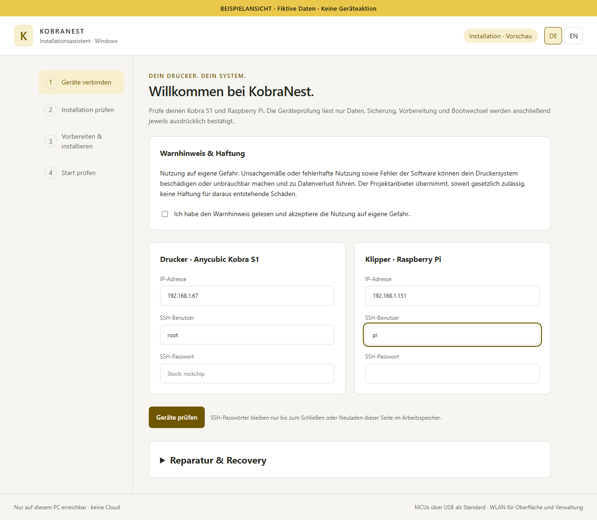
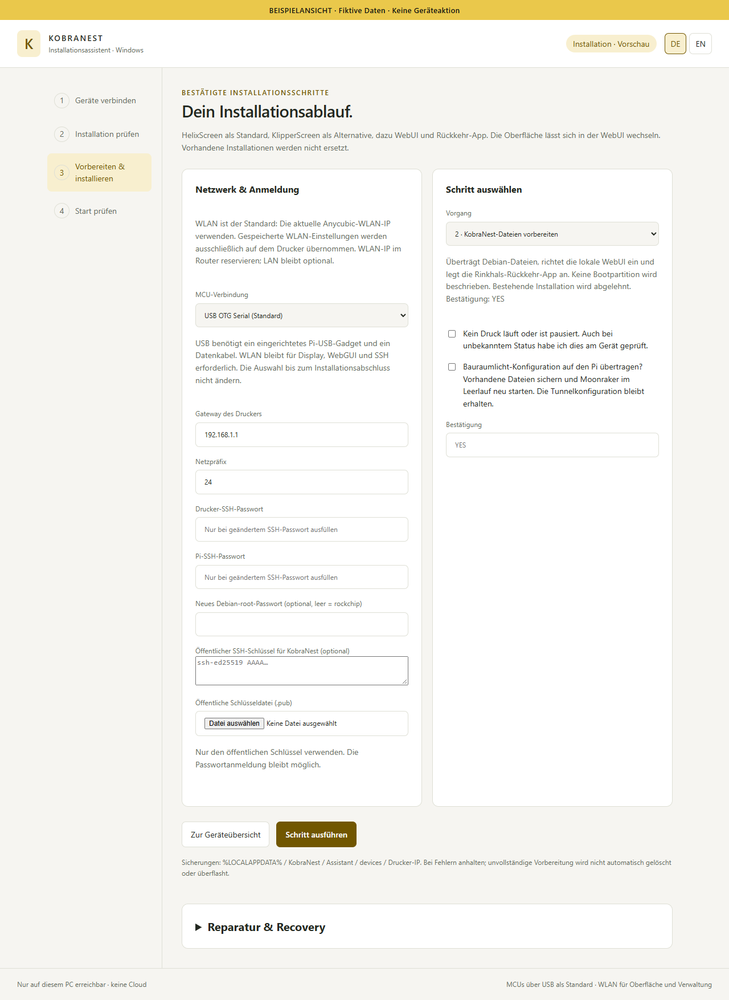
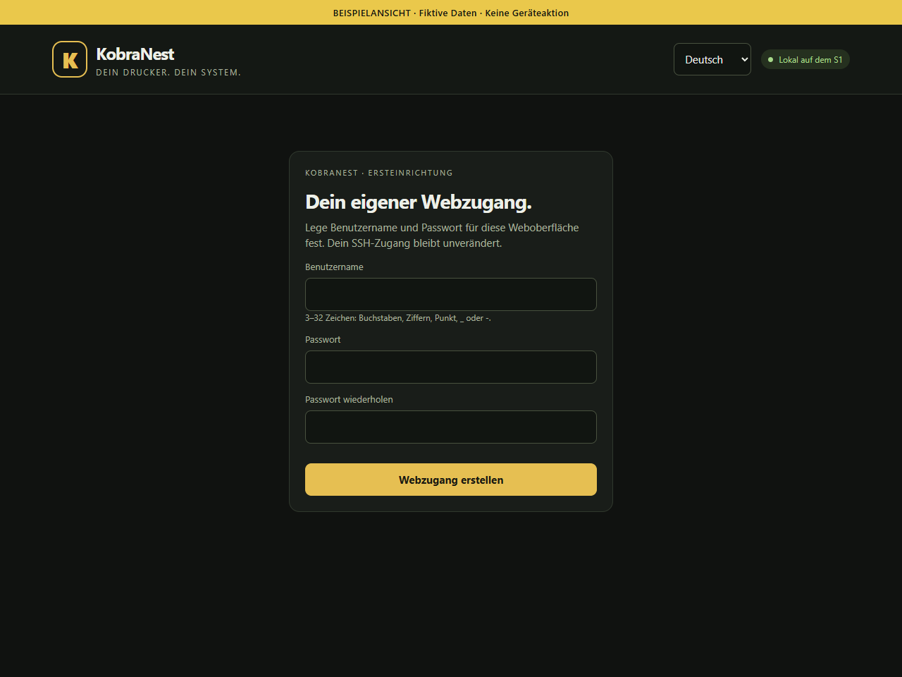
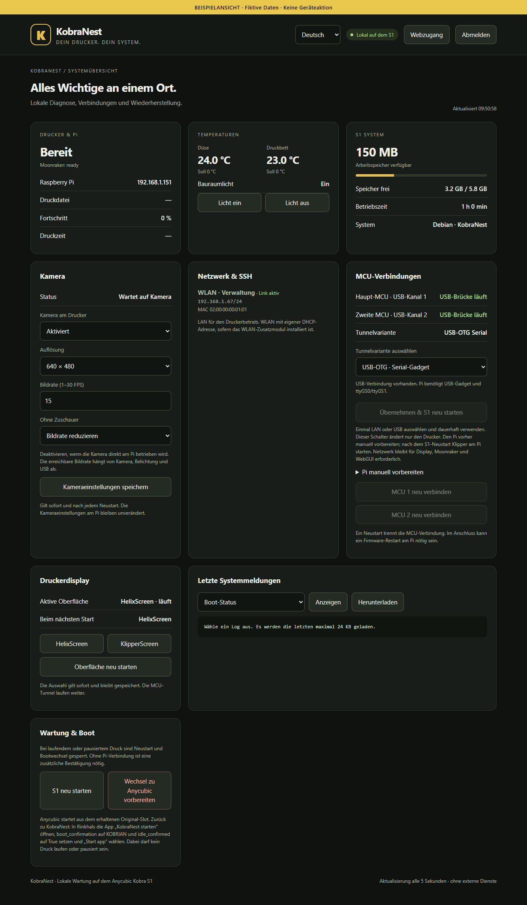
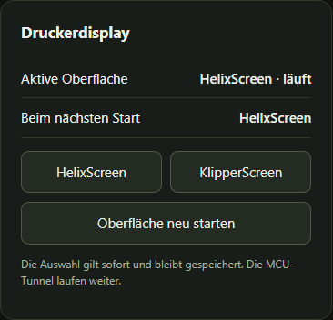
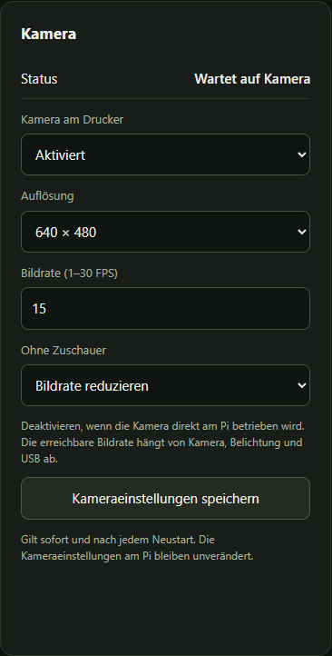
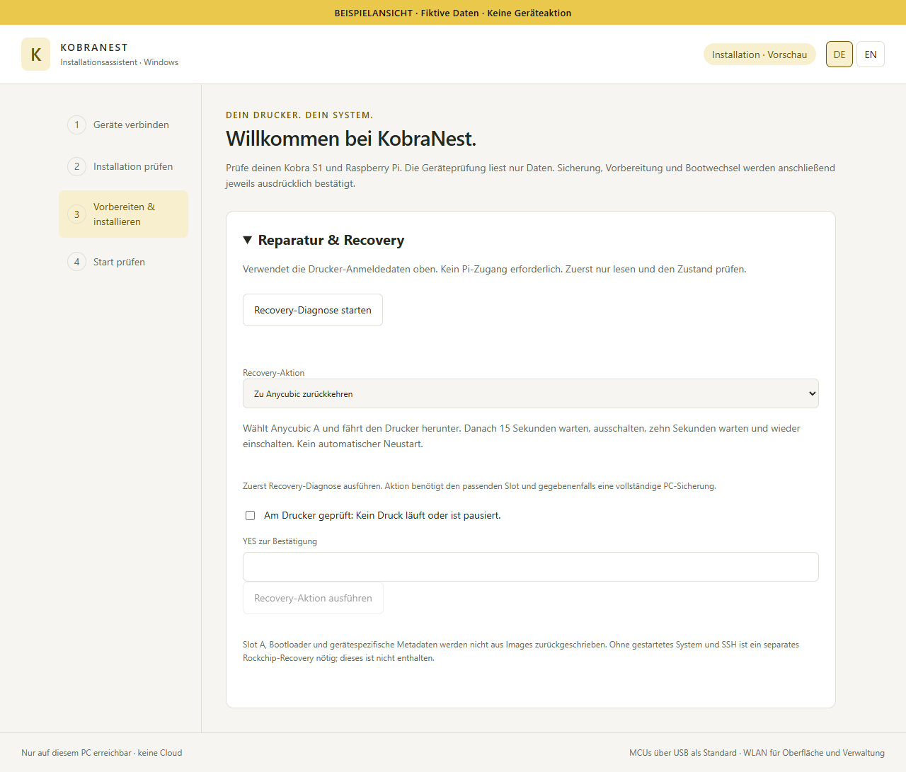

# KobraNest – bebilderte Anleitung

Vom eingerichteten Rinkhals-System zu KobraNest.

Stand / Updated: 2026-10-23 · KobraNest S1 v0.1

**Diese Anleitung setzt Rinkhals und einen bereits funktionierenden USB- oder kabelgebundenen LAN-Tunnel zu Klipper/Moonraker auf dem Pi voraus. Tunnel-Einrichtung, Verkabelung und Lötarbeiten sind nicht Teil dieser Anleitung.**

Die Bilder zeigen die tatsächlichen Programmoberflächen mit fiktiven Beispieldaten. Sie dokumentieren keine ausgeführte Installation. Eigene IP-Adressen und Zugangsdaten verwenden; Beschriftungen können sich mit Updates ändern.

## Vor dem Start

Das vollständige Installationspaket von der GitHub-Release-Seite herunterladen und vollständig entpacken. Unter Windows Start-KobraNest.cmd öffnen; _internal und alle Paketdateien müssen zusammenbleiben. Unter Linux den Python-Assistenten wie in ANLEITUNG-DE.md starten. Die lokale Browserseite und Konsole bis zum Abschluss offen lassen.

Nur ohne laufenden oder pausierten Druck installieren. Den Warnhinweis lesen und bestätigen. Während Übertragung und Aktivierung nicht ausschalten.

## 1 · Geräte verbinden

Die aktuelle Drucker-IP aus dem bereits eingerichteten Anycubic-WLAN und die Pi-IP eintragen. Druckerbenutzer normalerweise root; das aktuelle SSH-Passwort verwenden. Die Pi-Zugangsdaten stammen aus deiner eigenen Einrichtung. WLAN ist der übliche Verwaltungszugang, auch wenn die MCU-Verbindung über USB läuft.

Die Geräteprüfung liest nur Daten. Neue SSH-Fingerabdrücke unabhängig vergleichen und erst danach bestätigen. Passwörter bleiben für die aktuelle Browser-Sitzung im Arbeitsspeicher; bei späteren Schritten nur bei einer Änderung neu eintragen.

## 2 · Prüfen, sichern und bauen

Die Geräteprüfung muss Paket, Druckerplattform, SSH und Pi-Voraussetzungen bestätigen. Eine Neuinstallation beginnt im Originalsystem auf Slot A. Wird bereits KobraNest auf Slot B erkannt, keine saubere Neuinstallation erzwingen.

Im Installationsablauf zuerst Sicherung & Build wählen. Leerlauf bestätigen und YES eingeben. Die eigene Gerätesicherung auf dem PC aufbewahren. Bei einer Fehlermeldung deren Ursache klären; keine Sicherungen oder Systemordner auf Verdacht löschen.

## 3 · KobraNest-Dateien vorbereiten

Den Schritt „KobraNest-Dateien vorbereiten“ auswählen. Die MCU-Verbindung muss zu deinem bereits funktionierenden Rinkhals-Tunnel passen: USB ist vorausgewählt; Netzwerk ist nur für kabelgebundenes LAN gedacht. Die Auswahl während der Installation nicht ändern.

Gateway und Netzpräfix kontrollieren. Optional ein neues Debian-root-Passwort und einen öffentlichen SSH-Schlüssel (.pub) hinterlegen; niemals einen privaten Schlüssel einfügen. Die optionale Übertragung der Bauraumlicht-Konfiguration bewusst auswählen: Sie sichert vorhandene Dateien und startet Moonraker im Leerlauf neu. Das ist keine automatische Einrichtung des Tunnels. YES und Leerlaufbestätigung geben nur den ausgewählten Schritt frei.

## 4 · Slot B aktivieren und Start prüfen

Erst nach erfolgreicher Vorbereitung aktivieren. Die bestehende Pi-Konfiguration muss zur ausgewählten MCU-Verbindung passen. Die Pi-Bereitschaft und den Leerlauf bestätigen und das im Formular verlangte YES eingeben. Slot A bleibt erhalten; der Assistent schreibt die vorgesehenen Slot-B-Partitionen und prüft das Ergebnis.

Während Schreiben und Neustart nichts unterbrechen. Anschließend „Start prüfen“ ausführen; einen neuen Debian-SSH-Schlüssel zuerst unabhängig prüfen. Am Drucker Bild, Touch, plausible Temperaturen, Klipper ready und Bauraumlicht kontrollieren. Ein bestätigter lokaler Bootstatus allein beweist noch keine MCU-Verbindung.

## 5 · Eigenen Webzugang anlegen

Im Browser http://DRUCKER-IP:8080 öffnen und beim ersten Aufruf einen eigenen Webbenutzer mit Passwort anlegen. Dieser Zugang ist getrennt von SSH; root / rockchip ist kein automatisch eingerichtetes Webkonto.

Benutzername und Passwort sicher aufbewahren. Die Sprache lässt sich oben zwischen Deutsch und Englisch wechseln.

## 6 · Systemübersicht verwenden

Das Dashboard zeigt Klipper-/Pi-Status, Temperaturen, verfügbaren RAM, freien Speicher, Netzwerkadressen und MCU-Brücken. Hier lässt sich auch das Bauraumlicht bedienen. Beispielwerte in dieser Abbildung sind keine Sollwerte für deinen Drucker.

Der Tunnel-Umschalter ändert nur den Drucker. Ein Wechsel setzt eine passend vorbereitete Pi-Seite voraus und gehört nicht zur normalen Erstinstallation mit bereits funktionierendem Tunnel. WLAN bleibt für Verwaltung und Oberfläche nutzbar; ein LAN-MCU-Tunnel benötigt kabelgebundenes LAN.

## 7 · Display und Kamera

HelixScreen ist die Standardoberfläche; KlipperScreen bleibt als Alternative installiert. Die Auswahl im Bereich Druckerdisplay gilt sofort und für den nächsten Start. Nur im Leerlauf umschalten. Die getestete Paketversion enthält HelixScreen 1.1.0-beta.11; spätere ACE-Erweiterungen sind davon getrennt.

Die Kameraeinstellungen gelten für eine am Drucker angeschlossene Kamera. Wenn die Kamera direkt am Pi betrieben wird, die Druckerkamera bei Bedarf deaktivieren. Einstellungen am Pi werden dadurch nicht geändert.

## Kameraeinstellungen im Detail

Aktivierung, Auflösung, gewünschte Bildrate und Reduzierung ohne Zuschauer lassen sich einstellen und speichern. Die tatsächlich erreichbare Bildrate hängt von Kamera, USB und Belichtung ab.

Eine gewünschte Bildrate ist keine Garantie für die erreichbaren FPS. Ohne angeschlossene Kamera kann der Status „Wartet auf Kamera“ erscheinen.

## 8 · Hilfe und Recovery

Bei Problemen zuerst „Reparatur & Recovery“ aufklappen und die nur lesende Diagnose starten. Dafür werden die Drucker-Anmeldedaten benötigt; ein Pi-Zugang ist für die Recovery-Diagnose nicht erforderlich.

Eine Schreibaktion erst nach passender Diagnose und mit YES sowie bestätigtem Leerlauf ausführen. Die Slot-B-Wiederherstellung benötigt Anycubic A und die eigene geprüfte PC-Sicherung. Bei Rückkehr zu Anycubic die angezeigte Abschaltfolge befolgen: nach Herunterfahren mindestens 15 Sekunden warten, ausschalten, zehn Sekunden warten und wieder einschalten. Ist kein System mit SSH mehr erreichbar, ist das hier enthaltene Recovery nicht ausreichend; USB-/Bootloader-Recovery ist nicht Bestandteil.

## Weiterführende Anleitungen

- [GitHub / Download](https://github.com/moosbewohner/KobraNest/releases/tag/v0.1.8)
- [Deutsch](ANLEITUNG-DE.md) · [English](ASSISTANT-EN.md)
- [Recovery](RECOVERY.md) · [SSH](SSH.md)
