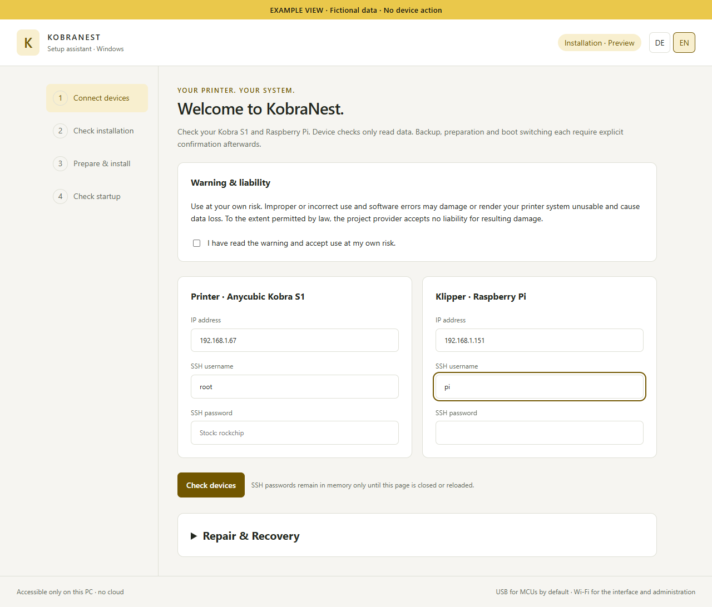
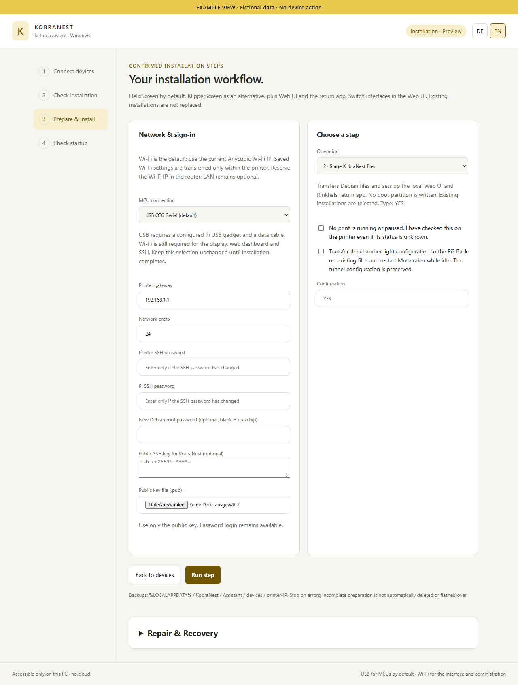
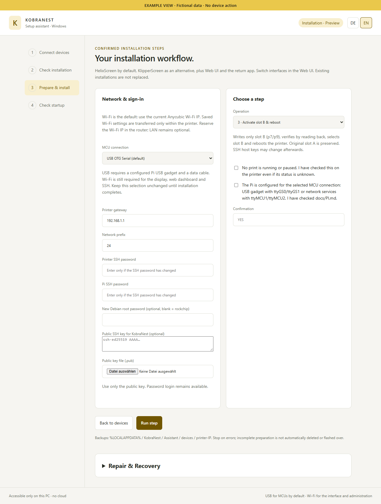
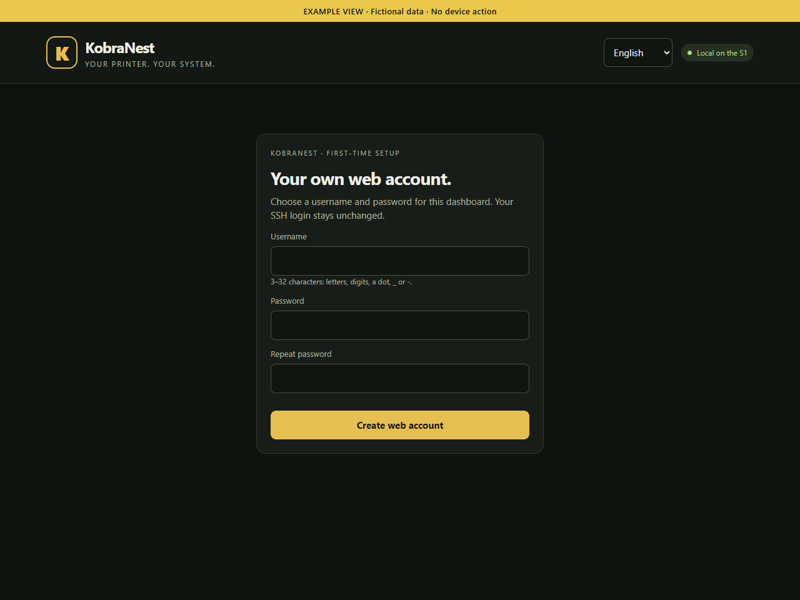
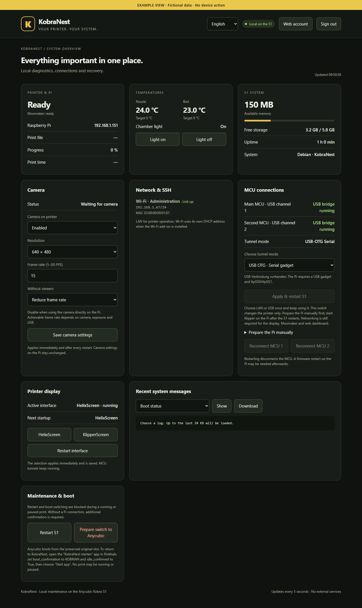
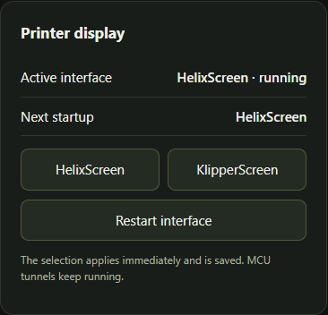
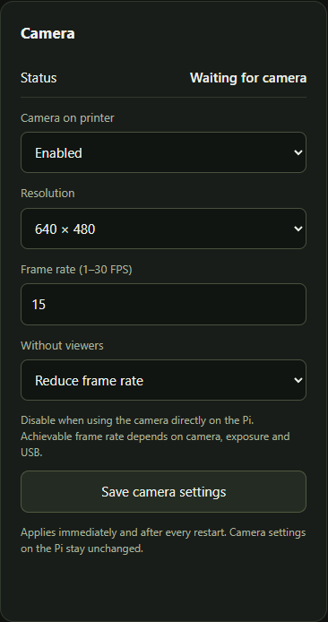
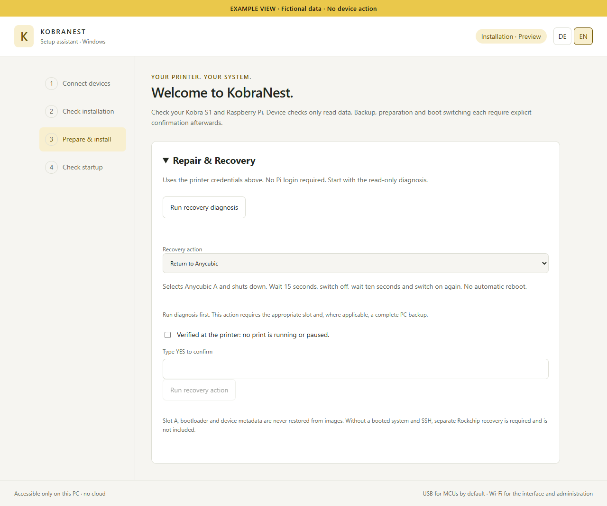

# KobraNest – illustrated guide

From an existing Rinkhals setup to KobraNest.

Stand / Updated: 2026-10-23 · KobraNest S1 v0.1

**This guide assumes Rinkhals and an already working USB or wired LAN tunnel to Klipper/Moonraker on the Pi. Tunnel setup, cabling and soldering are outside its scope.**

Images show the actual application interfaces with fictional example data. They do not document an installation being performed. Use your own addresses and credentials; labels may change with updates.

## Before starting

Download and fully extract the complete installation package from the GitHub release page. On Windows, open Start-KobraNest.cmd; keep _internal and all package files together. On Linux, start the Python assistant as described in ASSISTANT-EN.md. Keep the local browser page and console open until completion.

Install only when no print is running or paused. Read and acknowledge the warning. Do not interrupt power during transfer or activation.

## 1 · Connect the devices

Enter the current printer address from the existing Anycubic Wi-Fi setup and the Pi address. The printer user is usually root; use its current SSH password. Use your own Pi credentials. Wi-Fi is the usual administration connection even when MCU traffic uses USB.

Device checks only read data. Independently compare unfamiliar SSH fingerprints before approving them. Passwords stay in memory for this browser session; re-enter them in later steps only if they changed.

## 2 · Check, back up and build

The device check must confirm the package, printer platform, SSH and Pi prerequisites. A fresh installation starts in the original system on slot A. If KobraNest is already detected on slot B, do not force a fresh install.

Select Backup & Build first. Confirm that the printer is idle and enter YES. Keep the device-specific PC backup. Resolve errors before proceeding; do not delete backups or system directories on suspicion.

## 3 · Prepare KobraNest files

Select the step for preparing KobraNest files. Choose the MCU mode matching your already working Rinkhals tunnel: USB is preselected; network mode requires wired LAN. Keep this choice throughout installation.

Check the gateway and subnet prefix. Optionally set a new Debian root password and add a public SSH key (.pub); never paste a private key. Deliberately choose whether to transfer the chamber-light configuration: this backs up existing files and restarts Moonraker while idle. It does not set up the tunnel automatically. YES and the idle acknowledgement authorize only the selected step.

## 4 · Activate slot B and check startup

Activate only after preparation succeeds. The existing Pi setup must match the selected MCU mode. Confirm Pi readiness and printer idle state, and enter the YES requested by the form. Slot A is retained; the assistant writes the intended slot-B partitions and verifies them.

Do not interrupt writes or restart. Afterwards, select Check startup and independently verify any new Debian SSH key. On the printer, check the display, touch, plausible temperatures, Klipper ready and chamber light. Successful local boot confirmation alone does not prove MCU connectivity.

## 5 · Create your Web UI account

Open http://PRINTER-IP:8080 and create your own username and password on first use. This account is separate from SSH; root / rockchip is not an automatically configured Web UI account.

Keep your login details safe. Switch between German and English in the header.

## 6 · Use the dashboard

The dashboard shows Klipper/Pi status, temperatures, available RAM, free storage, addresses and MCU bridges. It also controls the chamber light. Example values in the image are not target values for your printer.

The tunnel selector changes only the printer. Switching requires the Pi to be prepared accordingly and is not part of a normal first installation with an already working tunnel. Wi-Fi remains optional for administration. The USB variant can also carry the interface connection; LAN MCU tunneling requires wired LAN.

## 7 · Display and camera

HelixScreen is the default; KlipperScreen remains installed as an alternative. Selecting a display interface applies immediately and persists after restart. Switch only while idle. The tested package includes HelixScreen 1.1.0-beta.11; later ACE extensions are separate.

Camera settings apply to a camera connected to the printer. If your camera is connected directly to the Pi, disable the printer camera if appropriate. This does not change camera settings on the Pi.

## Camera settings in detail

Enable or disable the camera, select resolution and requested frame rate, and choose whether to reduce the frame rate without viewers. Save the settings. Actual performance depends on the camera, USB and exposure.

Requested frame rate is not a guarantee of actual FPS. Waiting for camera may be displayed when no camera is connected.

## 8 · Help and recovery

When troubleshooting, expand Repair & Recovery and run the read-only diagnosis first. Printer credentials are required; the recovery diagnosis does not need Pi access.

Run a writing action only after an appropriate diagnosis, with YES and confirmed idle state. Restoring slot B requires Anycubic A and your own verified PC backup. When returning to Anycubic, follow the displayed power sequence: wait at least 15 seconds after shutdown, switch off, wait ten seconds, then switch on. If no system with SSH can boot, this recovery is insufficient; USB/bootloader recovery is not included.

## Further documentation

- [GitHub / Download](https://github.com/moosbewohner/KobraNest/releases/tag/v0.1.6)
- [Deutsch](ANLEITUNG-DE.md) · [English](ASSISTANT-EN.md)
- [Recovery](RECOVERY.md) · [SSH](SSH.md)
